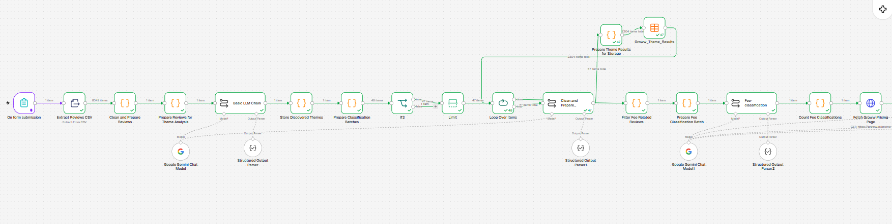
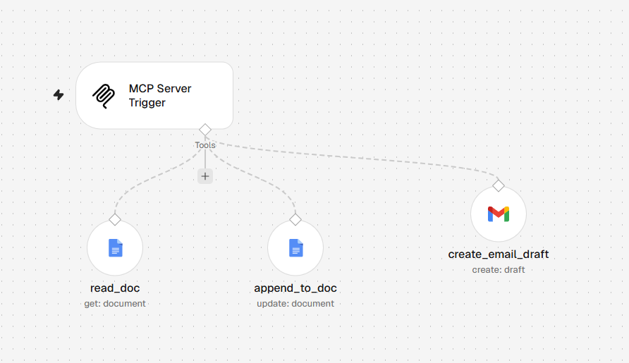

# Groww Review Pulse — AI-Powered Play Store Review Analyzer

An AI-powered workflow that transforms Google Play Store reviews into structured product insights, weekly sentiment reports, and actionable recommendations.

## Project Overview

Product teams receive thousands of app reviews, making it difficult to identify recurring customer complaints, understand sentiment changes, and prioritize product improvements.

**Groww Review Pulse** automates this process using n8n, Google Gemini, and MCP integrations.

The workflow processes Groww Play Store reviews, identifies customer feedback themes, analyses weekly trends, generates a fee explainer using official sources, and prepares a product report for review.

## Key Features

- **Review cleaning:** Removes blank reviews, short reviews, and duplicates.
- **Balanced sampling:** Limits the analysis dataset to a maximum of 200 reviews per week.
- **AI-powered theme discovery:** Identifies up to five distinct customer feedback themes.
- **Batch classification:** Classifies individual reviews into predefined themes using Google Gemini.
- **Sentiment and trend analysis:** Compares review volume, low ratings, high ratings, and average ratings across reporting periods.
- **Fee-related analysis:** Identifies fee-related reviews and classifies a pilot sample.
- **Official-source validation:** Generates a fee explainer using Groww's official pricing and help pages, followed by an AI fact-checking step.
- **Report generation:** Prepares a weekly product pulse with customer pain points and recommendations.
- **MCP integration:** Connects the workflow to Google Docs and Gmail for document verification, report append, and email draft creation.

## Architecture

```text
Google Play Store Reviews (CSV)
              |
              v
       n8n Main Pipeline
              |
              v
      Review Cleaning
              |
              v
      Theme Discovery
              |
              v
     Batch Classification
              |
              v
       Weekly Analysis
              |
              v
       Fee Analysis
              |
              v
   Official Source Validation
              |
              v
      Report Generation
              |
              v
        Human Review
              |
              v
        MCP Server
          /       \
         v         v
    Google Docs   Gmail Draft
```

## Technology Stack

| Technology | Purpose |
|---|---|
| Python | Review data preparation and preprocessing |
| n8n | Workflow orchestration and automation |
| Google Gemini | Theme discovery, classification, and report generation |
| MCP | Integration with external tools |
| Google Docs | Weekly report storage |
| Gmail | Email draft creation |
| GitHub | Source control and project showcase |
| Streamlit | Planned interactive dashboard |

## Workflow Components

### 1. Main Pipeline

File: `groww-review-pipeline-public.json`

The main n8n workflow handles:

1. CSV upload and extraction.
2. Review cleaning and duplicate removal.
3. Weekly review limits.
4. AI-powered theme discovery.
5. Batch-based review classification.
6. Weekly product pulse generation.
7. Fee-related review analysis.
8. Official-source fee explanation and fact-checking.
9. Final report and email content preparation.

### 2. MCP Server

File: `groww-review-mcp-server-public.json`

The MCP Server exposes three tools:

| Tool | Function |
|---|---|
| `read_doc` | Reads the existing weekly report to verify content and check duplicates. |
| `append_to_doc` | Appends an approved weekly report to Google Docs. |
| `create_email_draft` | Creates an email draft containing the weekly report. |

Human approval is part of the reporting process. The email integration creates a draft rather than automatically sending the report.

## Analysis Scope

The current analysis run includes:

| Metric | Result |
|---|---:|
| Cleaned reviews available | 6,042 |
| Reviews selected for analysis | 2,404 |
| Unique classified review IDs | 2,404 |
| Duplicate theme records | 0 |
| Discovered themes | 5 |

### Discovered Customer Themes

| Theme ID | Theme |
|---|---|
| T1 | Technical Performance and Stability |
| T2 | Customer Support and Operational Delays |
| T3 | Pricing and Fee Structure |
| T4 | UI/UX Design and Feature Gaps |
| T5 | Ease of Use and Accessibility |

**Important:** Fee classification was performed on a pilot sample of 25 out of 227 fee-related reviews. Its findings are provisional and should not be interpreted as conclusions from the entire fee-related dataset.

## Official Sources

The fee explainer uses the following official Groww resources:

- [Groww Pricing](https://groww.in/pricing)
- [Groww Help Centre — Additional Charges](https://groww.in/help/payments-%26-withdrawals/payments-charges/apart-from-brokerage--what-fees-am-i-charged--93)

## Setup and Configuration

The repository contains sanitized n8n workflow exports for reference and reuse.

To run the workflows in your own n8n instance:

1. Import the main pipeline JSON.
2. Configure your own Google Gemini credentials.
3. Configure the required n8n Data Table.
4. Import the MCP Server workflow separately.
5. Configure your own Google Docs and Gmail credentials.
6. Configure the MCP endpoint and authentication.
7. Replace document references, recipient details, and other environment-specific settings.
8. Upload your own review CSV and test the workflow.

**Note:** The exported workflows are templates, not turnkey deployments. Credentials, Data Tables, document references, and environment-specific configuration must be supplied by the user.

## Project Status

- [x] Review cleaning and preparation
- [x] AI theme discovery
- [x] Batch-based theme classification
- [x] Weekly product pulse generation
- [x] Fee explainer and fact-check workflow
- [x] Google Docs and Gmail MCP integration
- [x] Sanitized n8n workflow exports
- [ ] Streamlit dashboard
- [ ] Cloud deployment

## Future Improvements

- Interactive Streamlit dashboard for product insights.
- Visualize weekly rating and review-volume trends.
- Explore customer feedback by theme.
- Track recurring product pain points.
- Enable easier report exploration and sharing.

## Disclaimer

This is an independent portfolio project built for product analytics and workflow automation demonstration. It is not affiliated with or endorsed by Groww.

AI-generated classifications and recommendations may require human review. Fee information should always be checked against the latest official Groww sources.

---

**Built with Python, n8n, Google Gemini, and MCP.**

## Workflow Screenshots

### 1. Complete n8n Workflow


### 2. Review Processing and AI Classification


### 3. Reporting and Fact-Checking


### 4. MCP Server Architecture

